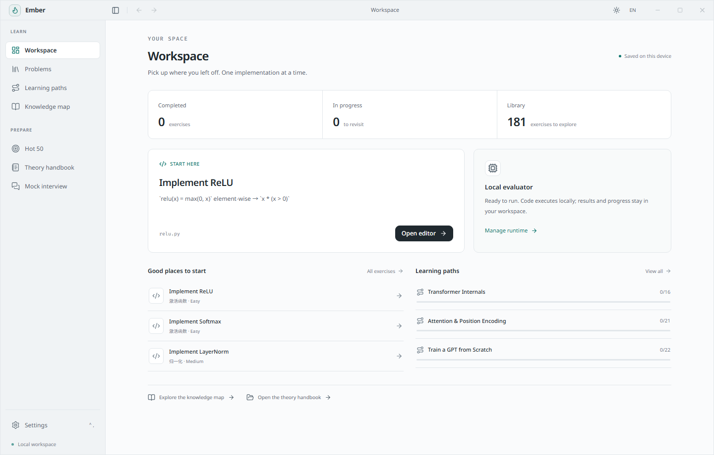
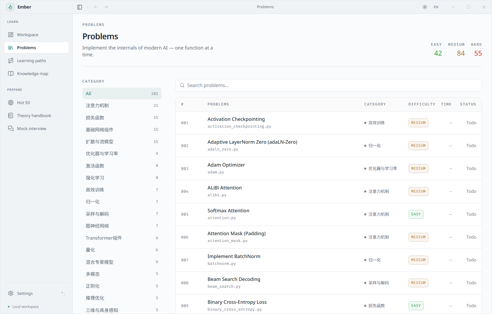
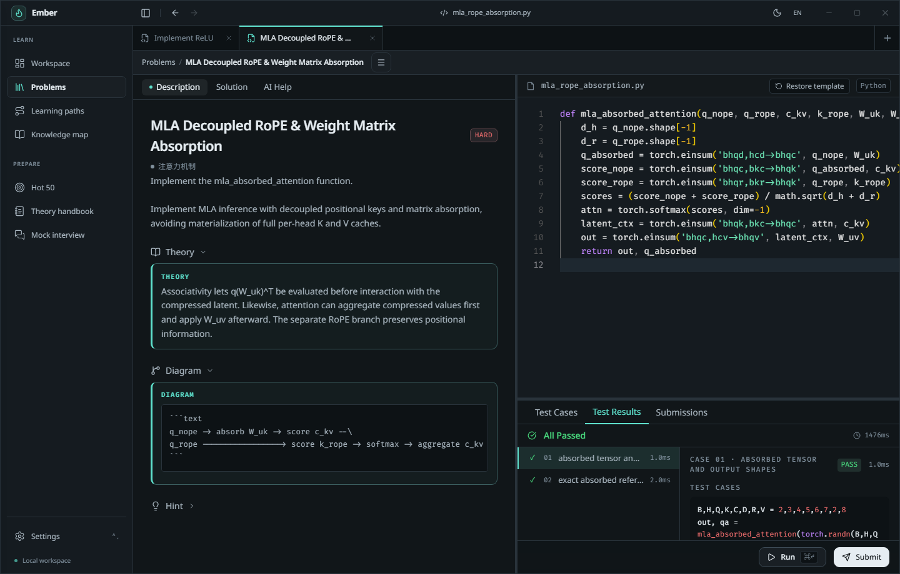
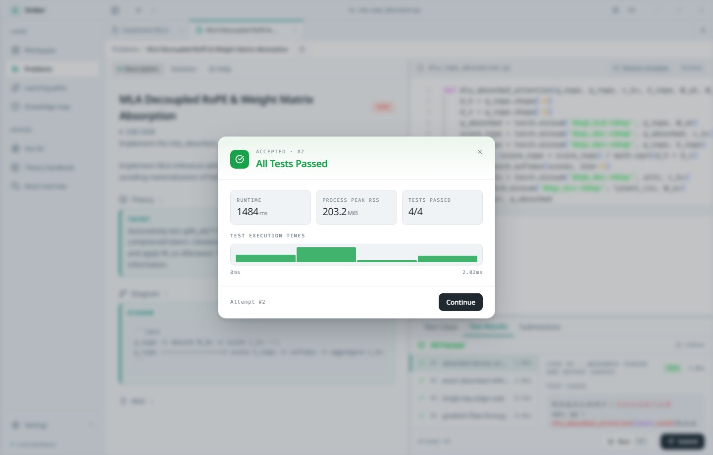
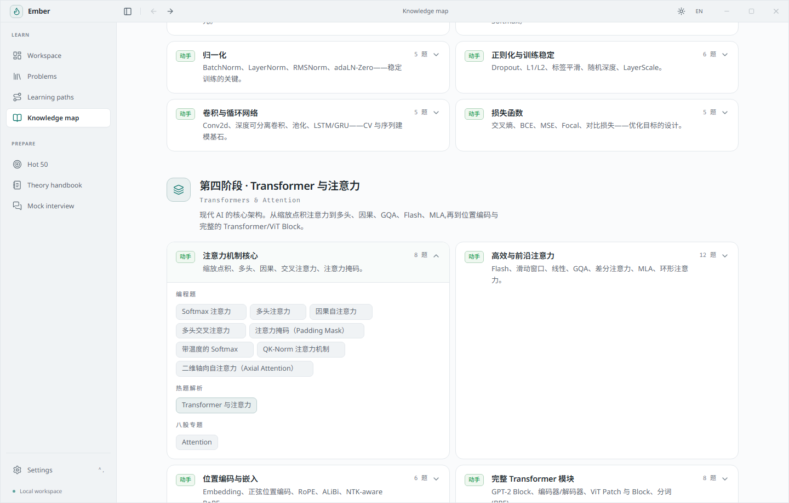
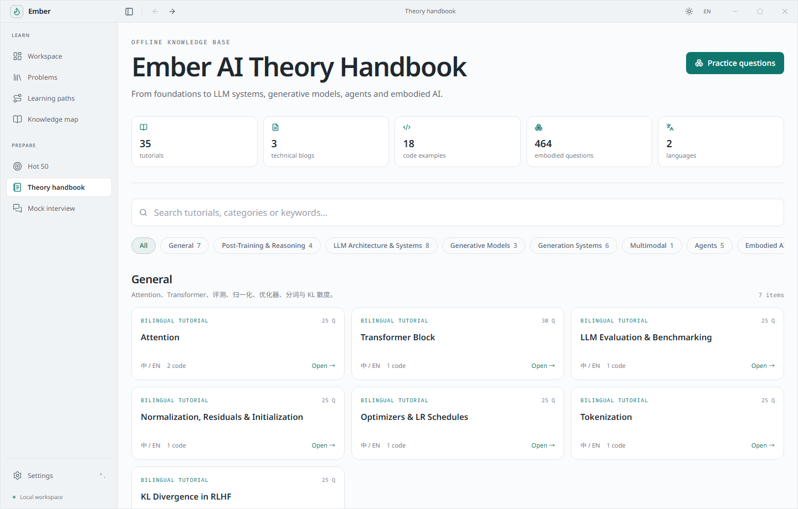

<div align="center">


# Ember

**从零手撕现代 AI 系统的核心算子与架构 —— 本地优先的 PyTorch 实战与面试训练场**

[English](./README.md) | 简体中文

[](#核心题库全景181-道-pytorch-手撕题)
[](#12-条结构化学习路线)
[](#六位一体的-ai-工程师工作台)
[](#六位一体的-ai-工程师工作台)
[](#系统架构与安全沙箱)
[](./LICENSE)

</div>

## 界面预览

<p align="center">
  <a href="./docs/assets/screenshots/workspace-overview.png">
    
  </a>
  <br />
  <sub><b>你的本地 AI 工程师训练工作台</b> —— 181 道实战题、12 条学习路径与真实 PyTorch 评测。</sub>
</p>

| | |
| :---: | :---: |
| [](./docs/assets/screenshots/workspace-overview.png)<br><sub><b>工作台概览</b> · 学习进度、推荐练习与学习路线</sub> | [](./docs/assets/screenshots/problems-catalog.png)<br><sub><b>181 道编程题库</b> · 难度统计与分类筛选</sub> |
| [](./docs/assets/screenshots/coding-editor-dark.png)<br><sub><b>高阶编程工作区</b> · 深色模式、多题标签与实时测试结果</sub> | [](./docs/assets/screenshots/submission-accepted.png)<br><sub><b>提交通过</b> · 运行耗时、峰值内存与逐测试计时</sub> |
| [](./docs/assets/screenshots/curriculum-map.png)<br><sub><b>八阶段知识地图</b> · 编程题、热题 50 与手册章节联动</sub> | [](./docs/assets/screenshots/theory-handbook.png)<br><sub><b>双语理论手册</b> · 深度教程、技术长文与面试练习</sub> |

---

## 为什么选择 Ember？

准备大模型（LLM）、多模态（VLM）、扩散生成（Diffusion/Flow）或具身智能（Embodied AI）算法岗面试时，**“看懂论文公式”与“在白板/编辑器里独立写出无 Bug、梯度正确的 PyTorch 代码”之间隔着巨大的鸿沟**。

**Ember** 是一套专为 AI 算法工程师与研究者打造的**本地优先（Local-First）、完全离线可用**的桌面实战训练环境。它基于 **Tauri 2 + Rust + React** 构建，将“在线 OJ 级 PyTorch 手撕代码评测”、“体系化理论手册”与“沉浸式模拟面试”浓缩进一个极速原生桌面应用中：

- **真实 PyTorch 沙箱评测，拒绝伪代码与 Mock**：每一道题都运行在受资源预算（CPU、内存、超时）保护的独立 PyTorch 子进程沙箱中，逐项校验**张量形状、数值精度、极端边界条件，以及 `autograd` 梯度流向**（严格检验 `detach` 停止梯度、直通估计器 STE 等工程细节）。
- **零依赖开箱即用**：无需配置 Python 环境、无需联网，启动应用即可离线浏览全部 **181 道手撕题目、参考源码、公式推导、12 条学习路径、35 篇中英双语理论手册与 1,316 道面试真题**。需要动手跑代码时，再一键挂载本地 Python 环境或签名评测模块。
- **从经典积木到 2025–2026 最前沿架构全覆盖**：不仅有 MHA、RoPE、LoRA、PPO、DPO，更完整收录 **DeepSeek-V3/R1（MLA 矩阵吸收、无辅助损失路由、链式 MTP、GRPO、DAPO）、Qwen2-VL（M-RoPE）、Flux/SD3（MMDiT、Flow Matching、Flow-GRPO）、Sora/CogVideoX（Causal Conv3D）、Cosmos-3（MoT 架构）、DreamerV3、JEPA/VICReg、OpenVLA/ACT、3DGS、NeRF** 等核心算法实现。
- **多标签页 IDE 工作台与苏格拉底式 AI 助教**：支持多题并发编辑、草稿自动持久化、测试用例自定义扩展；可接入任意 OpenAI 兼容接口，基于当前报错与代码提供“启发式排查指导”而非直接剧透答案。

---

## 六位一体的 AI 工程师工作台

| 核心板块 | 内容规模 | 核心体验与亮点 |
| :--- | :--- | :--- |
| **编程题库** (`/problems`) | **181 道可评测 PyTorch 手撕题**（`42 简单` · `84 中等` · `55 困难`），横跨 19 大技术分类 | 中英双语题面、折叠式数学原理精讲、Mermaid 数据流图、分步提示、完整注释参考答案与可运行 Demo |
| **学习路径** (`/paths`) | **12 条循序渐进的专题路线**，覆盖从 Transformer 底层到具身智能 | 自动追踪每条路径的已解决进度、最佳耗时与前置依赖 |
| **知识体系** (`/curriculum`) | **8 大阶段 · 32 个核心知识模块**的 AI 工程师全景知识树 | 将每一个理论考点直接关联到对应的**动手编程题、热题 50 解析与八股专题章节**，学完即练 |
| **理论手册** (`/bagu`) | **35 篇双语深度教程** + **3 篇前沿技术长文** + **9 卷具身智能面试题库** | 内置离线 MathJax 公式渲染、17 个配套纯 PyTorch 教学脚本与全文检索 |
| **热题 50** (`/hot`) | **50 道跨方向最高频 AI 面试母题**（覆盖数学、ML、DL、LLM、训练、推理、RAG、对齐） | 结构化标准回答模板，标注关键结论、易错陷阱与原始论文出处 |
| **模拟面试** (`/interview`) | **双模真题抽卡器**：1,316 道八股问答题 + 181 道手撕代码题随机抽取 | 八股模式采用“先思考组织语言、再点击揭晓答案”；代码模式一键跳转 IDE 实战编写 |

---

## 核心题库全景（181 道 PyTorch 手撕题）

Ember 的 181 道编程题均提炼自真实算法岗高频手撕题与顶级论文核心算子，每道题配备 **4 组以上独立测试样例**（形状检查、固定种子数值对齐、边界条件、反向传播梯度检查）。

<details open>
<summary><b>1. 注意力机制与长上下文外推（24 题）</b></summary>

- **基础与变体注意力**：缩放点积注意力 (`attention`)、多头注意力 (`mha`)、因果自注意力 (`causal_attention`)、多头交叉注意力 (`cross_attention`)、Padding 掩码 (`attention_mask`)、QK-Norm 注意力 (`qk_norm_attention`)。
- **KV 压缩与前沿注意力**：分组查询注意力 (`gqa`)、DeepSeek 多头潜在注意力 (`mla`)、**MLA 解耦 RoPE 与推理期矩阵吸收** (`mla_rope_absorption`)、差分注意力 (`diff_attention`)、**Gemma-2 注意力 Logit 软截断与 StreamingLLM 汇聚掩码** (`attn_softcap_and_sink`)。
- **IO 感知、分布式与稀疏注意力**：分块 FlashAttention (`flash_attention`)、分布式环形注意力 (`ring_attention`)、vLLM 分页注意力 (`paged_attention`)、滑动窗口注意力 (`sliding_window`)、**分块 Top-K 稀疏注意力** (`block_topk_attention`)、**二维轴向自注意力** (`axial_attention`)。
- **线性注意力与递推算子**：核函数线性注意力 (`linear_attention`)、**分块并行因果线性注意力** (`chunkwise_linear_attention`)、**DeltaNet 擦除-写入递推注意力** (`deltanet_recurrence`)。
- **位置编码与长窗口外推**：正弦位置编码 (`sinusoidal_pe`)、旋转位置编码 (`rope`)、NTK-Aware RoPE (`ntk_rope`)、**YaRN 频率斜坡插值与注意力温度缩放** (`yarn_rope`)、ALiBi 线性偏置注意力 (`alibi`)。

</details>

<details open>
<summary><b>2. 混合专家模型（MoE）、状态空间模型与前沿 LLM 组件（14 题）</b></summary>

- **MoE 路由与均衡**：稀疏 Top-K 混合专家 (`moe`)、**DeepSeek-V3 无辅助损失 Sigmoid 动态偏置路由** (`deepseek_moe_router`)、带噪声 Top-K 门控 (`noisy_topk_gating`)、Switch 负载均衡损失 (`moe_load_balance`)、**MoE 路由器 Z-Loss** (`moe_router_z_loss`)、**混合深度路由（MoD）与专家选择路由（Expert-Choice）** (`mod_and_expert_choice`)。
- **骨干网络与前馈层**：GPT-2 Transformer Block (`gpt2_block`)、完整 Transformer 编码器 (`transformer_encoder`) 与解码器 (`transformer_decoder`)、SwiGLU 门控前馈网 (`mlp`, `swiglu`)、**GeGLU 前馈网络** (`geglu`)、Mamba 选择性状态空间模型步 (`mamba_ssm`)。
- **多 Token 预测（MTP）**：Meta 并行多头 MTP (`multi_token_prediction`)、**DeepSeek-V3 链式因果 MTP 模块** (`deepseek_mtp_module`)。

</details>

<details open>
<summary><b>3. 后训练、RLHF 偏好对齐、推理模型与强化学习（18 题）</b></summary>

- **偏好对齐损失家族**：DPO 直接偏好优化 (`dpo_loss`)、**SimPO 无参考模型长度归一化损失** (`simpo_loss`)、**ORPO 优势比偏好优化损失** (`kto_orpo_loss`)、**IPO 平方间距与 KTO 前景理论对齐损失** (`ipo_and_kto_loss`)、Bradley-Terry 奖励模型损失 (`reward_model`)。
- **强化学习后训练与在线蒸馏**：PPO 裁剪策略损失 (`ppo_loss`)、DeepSeek **GRPO 组相对策略优化损失** (`grpo_loss`)、**DAPO 非对称 Clip-Higher 与 Token 级策略损失** (`dapo_loss`)、**RLOO 留一法优势估计与 PRM 步骤评分聚合** (`rloo_and_prm_aggregation`)、**RLHF 中的 Schulman KL 估计器 ($k_1, k_2, k_3$)** (`kl_estimators_rlhf`)、**在线策略蒸馏广义 JS 散度 (GKD)** (`gkd_generalized_jsd`)。
- **树搜索与深度强化学习核心**：**AlphaZero / 推理模型 PUCT 节点选择** (`puct_selection`)、推理 MCTS (`mcts_search`)、**广义优势估计 (GAE)** (`generalized_advantage_estimation`)、**SAC 压缩高斯策略与 Tanh 雅可比修正对数概率** (`sac_squashed_gaussian`)、**离线强化学习 CQL 与 IQL 期望分位数损失** (`cql_iql_loss`)、**Double DQN 与 TD3 双 Q 目标计算** (`double_dqn_td3_target`)。

</details>

<details open>
<summary><b>4. 扩散模型、流匹配、离散潜变量与图像/视频生成（18 题）</b></summary>

- **流匹配与扩散基础理论**：流匹配损失 (`flow_matching`)、**流匹配 Heun 二阶 ODE 采样步** (`flow_heun_sampler`)、**DDPM 后验分布与 $v$-Prediction 互转** (`ddpm_posterior_and_vpred`)、DDIM 确定性采样步 (`ddim_step`)、扩散噪声调度 (`noise_schedule`)、**Min-SNR-$\gamma$ 损失加权与 Karras EDM 预处理系数** (`min_snr_and_edm_precond`)、**无分类器引导 (CFG) 与标准差重缩放** (`classifier_free_guidance`)。
- **扩散后训练、蒸馏与扩散语言模型**：**Flow-GRPO 逆向 SDE 采样步与速度场 KL** (`flow_grpo_sde_loss`)、**Diffusion-DPO 与 REPA 表征对齐损失** (`diffusion_dpo_repa_loss`)、**一致性蒸馏 (Consistency Distillation) 与伪 Huber 损失** (`consistency_distillation_loss`)、**掩码扩散语言模型 (MDLM) 与块因果注意力掩码** (`mdlm_and_block_diffusion`)。
- **视觉潜空间与 DiT / 视频架构**：**MMDiT 图文联合注意力** (`mmdit_joint_attention`)、DiT `adaLN-Zero` 调制 (`adaln_zero`)、**视频 VAE 时间因果三维卷积 (Causal Conv3D)** (`causal_conv3d`)、**VAE 重参数化与 $\beta$-ELBO** (`vae_elbo_reparam`)、**VQ-VAE 向量量化器与直通估计器 (STE)** (`vqvae_ste`)、**有限标量量化 (FSQ)** (`finite_scalar_quantization`)。

</details>

<details open>
<summary><b>5. 参数高效微调（PEFT）、模型量化、推理服务与分布式训练（19 题）</b></summary>

- **参数高效微调**：LoRA (`lora`)、**DoRA 权重幅值-方向分解低秩适配** (`dora_linear`)、**PiSSA 主奇异值低秩初始化** (`pissa_init`)、QLoRA (`qlora`)。
- **权重量化与激活量化**：对称 INT8 线性层 (`int8_quantization`)、**分组非对称 INT4 量化** (`groupwise_int4_quant`)、**QLoRA NF4 分位数码本与双重量化** (`nf4_double_quantization`)、**SmoothQuant 激活-权重平滑迁移** (`smoothquant_migration`)、**AWQ 激活显著度缩放与 GPTQ 黑塞误差补偿** (`awq_and_gptq_quant`)、**KIVI 非对称 KV Cache 量化（按通道 K / 按 Token V）** (`kivi_kv_cache_quant`)。
- **推理加速与采样解码**：KV Cache 注意力 (`kv_cache`)、**H2O 重命中与汇聚 Token KV 驱逐** (`h2o_kv_eviction`)、推测解码校验 (`speculative_decoding`)、**树状推测解码注意力掩码 (Medusa/EAGLE)** (`tree_speculative_mask`)、Top-k/Top-p 采样 (`topk_sampling`)、**Min-P 采样与重复惩罚过滤** (`min_p_sampling`)、束搜索 (`beam_search`)、带温度的 Softmax (`softmax_temperature`)。
- **分布式并行与预训练流水线**：张量并行 MLP (`tensor_parallel`)、FSDP 训练步 (`fsdp_step`)、**ZeRO-1/2/3 显存核算与 1F1B 流水线气泡率** (`zero_memory_accounting`)、混合精度训练步 (`mixed_precision`)、激活检查点 (`activation_checkpointing`)、**预训练文档拼接与文档内因果掩码** (`document_packing_mask`)、序列打包 (`sequence_pack`)、**Chinchilla 算力最优缩放定律** (`chinchilla_scaling`)。

</details>

<details open>
<summary><b>6. 多模态、RAG 检索、世界模型、三维视觉与具身智能控制（20 题）</b></summary>

- **多模态架构**：CLIP 图文对比模型 (`clip_model`)、**SigLIP 成对 Sigmoid 对比损失** (`siglip_loss`)、**Qwen2-VL 多模态三维旋转位置编码 (M-RoPE)** (`multimodal_3d_rope`)、**Cosmos-3 Mixture-of-Transformers (MoT) 非对称跨模态注意力** (`mot_asymmetric_attention`)、**VLM Pixel Unshuffle 视觉 Token 压缩** (`perceiver_resampler`)、ViT Patch Embedding (`vit_patch`) 与 ViT Block (`vit_block`)。
- **RAG 与检索重排**：**BM25 检索评分与倒数排名融合 (RRF)** (`bm25_rrf_retrieval`)、**ColBERT 晚期交互 MaxSim 评分** (`matryoshka_colbert_loss`)、InfoNCE 对比损失 (`contrastive_loss`)、余弦相似度 (`cosine_similarity`)。
- **世界模型与自监督表征**：**DreamerV3 Symlog 变换与 $\lambda$-Return** (`dreamer_world_model`)、**JEPA 潜空间预测与 VICReg 防坍缩正则损失** (`jepa_and_vicreg_loss`)。
- **三维视觉、VLA 与机器人控制**：**NeRF 体渲染方程 (Alpha 合成)** (`nerf_volume_rendering`)、**3D Gaussian Splatting 协方差矩阵与四元数旋转** (`gaussian_splatting_cov3d`)、**二维边界框 IoU 与非极大值抑制 (NMS)** (`box_iou_nms`)、**三维点云刚体配准 (Kabsch SVD 算法)** (`kabsch_pointcloud_align`)、**相机深度图三维反投影与最远点采样 (FPS)** (`pointcloud_fps_and_unproject`)、**VLA 动作分块时序集成 (ACT) 与 OpenVLA 离散化** (`act_openvla_actions`)、**阻尼最小二乘逆运动学 (DLS IK) 与关节 PD 控制** (`damped_least_squares_ik`)、**线性卡尔曼滤波预测与更新步** (`kalman_lqr_control`)、**SVD 主成分分析 (PCA) 与 CEM 交叉熵轨迹规划** (`kmeans_pca_and_cem`)。

</details>

<details>
<summary><b>7. 优化器、归一化、分词器、评测基准、图神经网络与深度学习基石（68 题）</b></summary>

- **优化器与学习率调度**：Adam (`adam`)、**AdamW 解耦权重衰减** (`adamw`)、**Lion 符号动量优化器** (`lion_optimizer`)、**Muon 优化器 Newton-Schulz 矩阵正交化** (`muon_orthogonalize`)、带动量的 SGD (`sgd_momentum`)、余弦退火学习率 (`cosine_lr`)、**WSD（预热-稳定-衰减）学习率调度** (`wsd_lr_schedule`)、梯度范数裁剪 (`gradient_clipping`)、梯度累积 (`gradient_accumulation`)。
- **归一化与残差稳定**：LayerNorm (`layernorm`)、RMSNorm (`rmsnorm`)、BatchNorm (`batchnorm`)、**组归一化 GroupNorm** (`groupnorm`)、**动态 Tanh 归一化替代层 (DyT)** (`dynamic_tanh`)、**DeepNorm 残差缩放与初始化增益** (`deepnorm_residual`)、LayerScale (`layerscale`)、随机深度 DropPath (`stochastic_depth`)、Dropout (`dropout`)、Kaiming 初始化 (`weight_init`)。
- **分词器与大模型评测基准**：字节对编码 BPE (`bpe`)、**WordPiece 子词分词器** (`wordpiece_tokenizer`)、**Unigram 维特比最优子词切分** (`unigram_viterbi`)、**Pass@k 无偏估计器** (`pass_at_k`)、**期望校准误差 (ECE) 与 Brier 分数** (`expected_calibration_error`)。
- **图神经网络（GNN）**：GCN 图卷积 (`gcn_layer`)、GAT 图注意力 (`gat_layer`)、GraphSAGE (`graphsage_layer`)、GIN 图同构层 (`gin_layer`)、MPNN 消息传递 (`mpnn_layer`)、图级池化读出 (`graph_readout`)、图自编码器 (`gae`)、链接预测 (`link_prediction`)。
- **激活函数、损失函数与基础算子**：ReLU (`relu`)、Leaky ReLU (`leaky_relu`)、GELU (`gelu`)、Sigmoid (`sigmoid`)、Tanh (`tanh`)、Softmax (`softmax`)、**数值稳定 LogSumExp 与 Log-Softmax** (`logsumexp_logsoftmax`)、交叉熵 (`cross_entropy`)、二元交叉熵 (`binary_cross_entropy`)、均方误差 (`mse_loss`)、Focal Loss (`focal_loss`)、KL 散度 (`kl_divergence`)、标签平滑 (`label_smoothing`)、L1/L2 正则化 (`l1_regularization`, `l2_regularization`)、二维卷积 (`conv2d`)、深度可分离卷积 (`depthwise_conv`)、最大池化 (`max_pool2d`)、LSTM 单元 (`lstm_cell`)、GRU 单元 (`gru_cell`)、线性层 (`linear`)、Embedding (`embedding`)、线性回归 (`linear_regression`)、Einsum (`einsum_ops`)、广播机制 (`broadcasting`)、One-Hot 编码 (`one_hot_encoding`)、残差连接 (`residual_connection`)。

</details>

---

## 12 条结构化学习路线

不知道从哪道题刷起？可以在 **学习路径（Paths）** 页面按精心编排的依赖顺序通关：

1. **Transformer 内部机制** —— 从激活函数、归一化、注意力到 GeGLU/SwiGLU 与完整 GPT-2 Block。
2. **注意力与位置编码** —— 从缩放点积与 RoPE 到 FlashAttention、YaRN、DeltaNet 与分块稀疏注意力。
3. **从零训练 GPT** —— Embedding、文档拼接掩码、AdamW/Lion/Muon、WSD 学习率调度与混合精度训练。
4. **推理与分布式训练** —— KV Cache、KIVI、H2O 驱逐、树状推测解码、张量并行、FSDP 与 ZeRO 显存核算。
5. **对齐与 Agent 推理** —— 奖励建模、Schulman KL、PPO、DPO、SimPO、ORPO、IPO/KTO、GRPO、DAPO、RLOO/PRM、GAE 与 PUCT。
6. **Vision Transformer 流水线** —— 卷积、Patch Embedding、轴向注意力、Pixel Unshuffle 与 SigLIP。
7. **扩散模型与 DiT** —— 噪声调度、DDPM/DDIM、Min-SNR/EDM、CFG、流匹配、Heun 二阶采样、Causal Conv3D、MMDiT 与 Flow-GRPO。
8. **LLM 前沿架构** —— GQA、差分注意力、MLA + 矩阵吸收、DeepSeek 无辅助损失 MoE、MoD、MDLM 与链式 MTP。
9. **图神经网络** —— GCN、GAT、GIN、MPNN、GraphSAGE、图池化读出、链接预测与 GAE。
10. **高效微调、量化与预训练缩放** —— LoRA、DoRA、PiSSA、QLoRA、NF4、INT8/INT4、SmoothQuant、AWQ/GPTQ、Chinchilla、Pass@k 与 ECE。
11. **RAG、世界模型与智能体** —— BM25 + RRF、ColBERT MaxSim、SigLIP、M-RoPE、MoT、DreamerV3 与 JEPA/VICReg。
12. **具身智能、三维视觉与机器人控制** —— 2D IoU/NMS、深度反投影与 FPS、Kabsch 配准、NeRF、3DGS、DLS 逆运动学、卡尔曼滤波、ACT/OpenVLA、SAC 与 CQL/IQL。

---

## 快速上手

### 1. 环境准备

- **Node.js** 22+
- **Rust** stable 工具链（Windows 需安装 MSVC 工具链与 Visual Studio C++ Build Tools）
- [Tauri 2 桌面环境依赖](docs/fern/pages/desktop/installation/install-desktop.mdx)

### 2. 启动桌面应用（仅浏览题库与手册无需 Python）

```bash
npm ci
npm run dev
```

Noto Sans、Noto Sans SC 与 Fira Code 可变字体已随应用离线打包，无需联网加载。

### 3. 配置本地 PyTorch 评测器（开发模式实时判题）

如果需要在应用中点击 **运行（Run）** 和 **提交（Submit）** 实时执行 PyTorch 测试用例，可创建虚拟环境并设置 `EMBER_DEV_PYTHON`：

**Windows (PowerShell)：**

```powershell
uv venv --python 3.12 .venv
uv pip install --python .venv/Scripts/python.exe -r modules/evaluator/requirements.txt
uv pip install --python .venv/Scripts/python.exe pytest
$env:EMBER_DEV_PYTHON = (Resolve-Path .venv/Scripts/python.exe).Path
npm run dev
```

**macOS / Linux：**

```bash
uv venv --python 3.12 .venv
uv pip install --python .venv/bin/python -r modules/evaluator/requirements.txt
uv pip install --python .venv/bin/python pytest
EMBER_DEV_PYTHON="$(pwd)/.venv/bin/python" npm run dev
```

> **说明**：`EMBER_DEV_PYTHON` 环境变量仅在 debug 开发构建中生效；正式发行安装包通过独立签名的评测模块（Ed25519 签名校验）运行本地评测。详见[源码开发指南](docs/fern/pages/developer-guide/development/build-from-source.mdx)。

---

## 系统架构与安全沙箱

```text
┌─────────────────────────────────────────────────────────────────────────┐
│                        Ember 桌面端 (Tauri 2)                           │
│   React 19 · TypeScript · Monaco 编辑器 · MathJax 3 · Tailwind CSS      │
└───────────────────────────────────┬─────────────────────────────────────┘
                                    │ Tauri IPC（零 HTTP 服务开销）
┌───────────────────────────────────▼─────────────────────────────────────┐
│                        Rust 核心层 (ember-core)                         │
│   • 题库与学习路径引擎              • SQLite 本地进度与多标签草稿存储    │
│   • 提交幂等控制与历史索引          • 苏格拉底式 AI 启发辅导代理        │
└───────────────────────────────────┬─────────────────────────────────────┘
                                    │ JSON-Lines 本地子进程协议
┌───────────────────────────────────▼─────────────────────────────────────┐
│                独立沙箱评测器 (ember-evaluator + Python)                │
│   • Ed25519 模块签名与完整性校验    • 一次性隔离工作子进程              │
│   • CPU / 墙钟超时 / RSS 内存硬限制 • 受限 Builtins 与白名单模块导入    │
└─────────────────────────────────────────────────────────────────────────┘
```

| 目录 | 职责说明 |
| :--- | :--- |
| `apps/desktop` | React 19 前端界面、Monaco 代码工作台、理论手册阅读器与 Tauri 2 桌面壳 |
| `crates/ember-core` | 题库目录管理、学习路径计算、SQLite 本地持久化与 AI 辅导请求代理 |
| `crates/ember-evaluator` | 本地评测子进程协议、模块安装升级回滚与 Ed25519 签名验证 |
| `modules/evaluator` | Python 独立评测运行时（单次任务进程隔离、内存与超时监控） |
| `torch_judge/tasks` | **181 道自包含 PyTorch 任务定义**（中英描述、提示、原理、流程图、测试与解答） |
| `content/catalog` | 随应用分发的题库目录、初始模板、参考题解与学习路径 JSON |
| `scripts` | 题库导出、模板构建、全量去重审计（`audit_deduplication.py`）与桌面端打包脚本 |

---

## 题库构建、测试与打包

修改或新增 `torch_judge/tasks/` 下的题目后，一键同步目录并执行全量去重校验：

```bash
npm run build:problems
npm run build:solutions
node scripts/run-python.js scripts/build_starters.py
node scripts/run-python.js scripts/audit_deduplication.py
```

运行完整检查与测试套件（Rust 核心契约测试、Python 真实沙箱评测与变异测试、前端编译、Playwright 端到端测试）：

```bash
npm run check:core
npm run test:python
npm run build:ui
cargo build --release -p ember-core --features developer-tools
npm --prefix apps/desktop exec -- playwright install chromium
npm --prefix apps/desktop test
```

构建原生桌面安装包：

```bash
npm run build:windows   # 在 target/release/bundle 下生成 Windows .msi 与 .exe 安装包
npm run build:macos     # 在 macOS 下生成 .app 与 .dmg 安装包
```

---

## 文档与致谢

- **开发与架构文档**：见 [`docs/README.md`](docs/README.md)（运行 `npm run docs:dev` 本地预览，运行 `npm run docs:check` 校验）。
- **开源致谢**：
  - 早期判题原型受 [TorchCode](https://github.com/duoan/TorchCode) 启发并深度重构扩充（原始版权声明保留于 [LICENSE](LICENSE)）。
  - 离线理论手册中的 35 篇双语教程与 3 篇技术长文源自杨若峰（Ruofeng Yang）开源的 [ARIS-in-AI-Offer](https://github.com/wanshuiyin/ARIS-in-AI-Offer)（MIT License）。
  - 具身智能 9 卷面试题库源自 WinstonJQ 开源的 [embodied-interview-qa](https://github.com/WinstonJQ/embodied-interview-qa)（MIT License）。
- **开源协议**：[MIT License](./LICENSE)。
