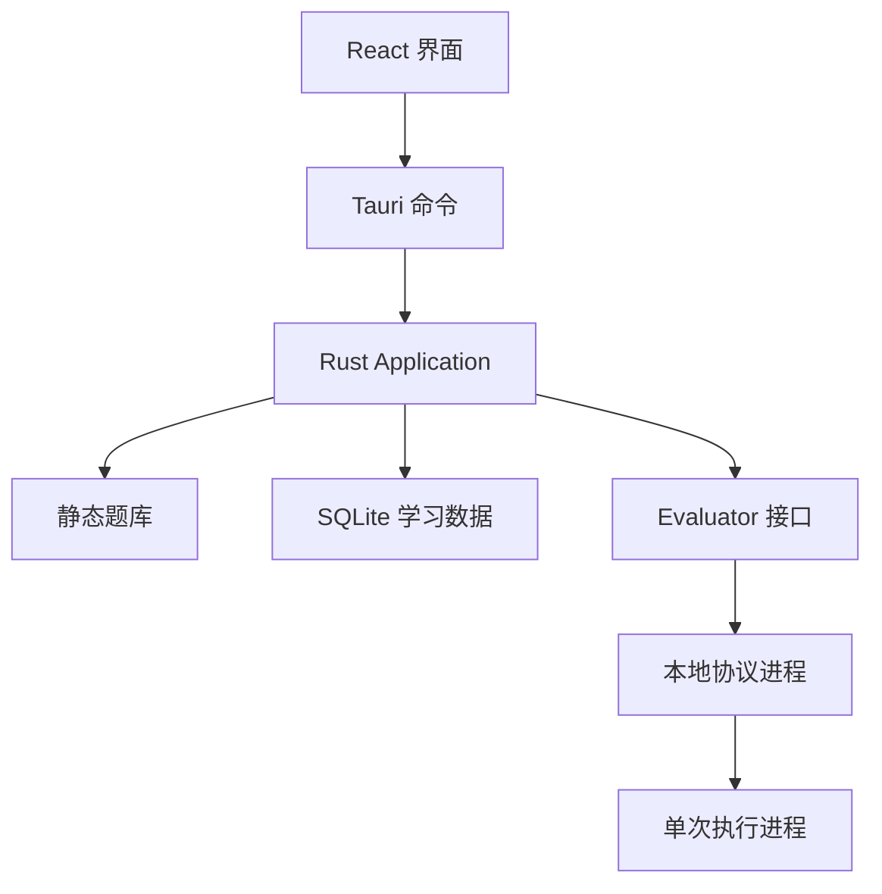

Ember 把学习数据与执行环境分开管理。Rust 核心拥有题库、学习记录和模块选择权；评测器只接收代码与测试选择，返回结果，不直接写入业务数据库。

## 请求路径

浏览题目走题库路径，读取进度和历史走 SQLite 路径；两者都不需要启动评测器。提交代码经过输入校验、单任务准入和持久化，再调用所选评测器。结果回到 Rust 后，提交结果与学习进度在同一事务中更新。

## 模块职责

| 路径 | 职责 |
| --- | --- |
| `apps/desktop` | 路由、编辑器、设置与 Tauri 壳 |
| `crates/ember-core` | 题库、应用用例、SQLite 和 AI 请求适配 |
| `crates/ember-evaluator` | 本地协议、模块安装与验证，以及尚不可用的 HTTP 预留接口 |
| `modules/evaluator` | Python 协议进程、预算检查和单次执行 |
| `content/catalog` | 随壳打包的展示与测试元数据 |
| `torch_judge/tasks` | 执行任务与测试的源码 |
| `scripts/desktop` | 导出、构建、签名、验收和性能工具 |
| `tests` | 题库构建回归测试与共享评测输入；评测器测试就近放在 `modules/evaluator` |

旧版 Next.js 网页端、`grading_service` 与 Python 远程服务均已移除。桌面与本地评测不依赖 HTTP 服务。`remote.rs` 仅保留标注“线上评测预留功能”的接口，调用时直接返回不可用，不发送请求。旧数据库的只读导入由 Rust 核心提供。

## 依赖方向

`ember-core` 依赖评测接口，接口不依赖前端或业务数据库。前端通过 Tauri 命令调用应用用例，不能直接启动 Python 或修改 SQLite。模块管理器负责下载与签名校验，执行适配器负责协议和进程生命周期，两者不互相承担学习状态更新。

这种边界允许模块与壳独立升级。本地执行遵循[评测协议](../../reference/evaluator/protocol.mdx)，独立升级仍须满足[兼容性约束](../../reference/compatibility.md)。

## 一致性边界

一次只接纳一个评测任务。评测与模块切换共用准入锁，避免运行途中换掉执行环境。基础设施失败留下可诊断的提交记录，但不改变学习进度。具体规则见[存储](storage.md)与[评测器生命周期](evaluator-lifecycle.md)。

实现入口：[Application](https://github.com/BGWH123/Ember/blob/main/crates/ember-core/src/application.rs)与[Tauri 命令](https://github.com/BGWH123/Ember/blob/main/apps/desktop/src-tauri/src/main.rs)。
