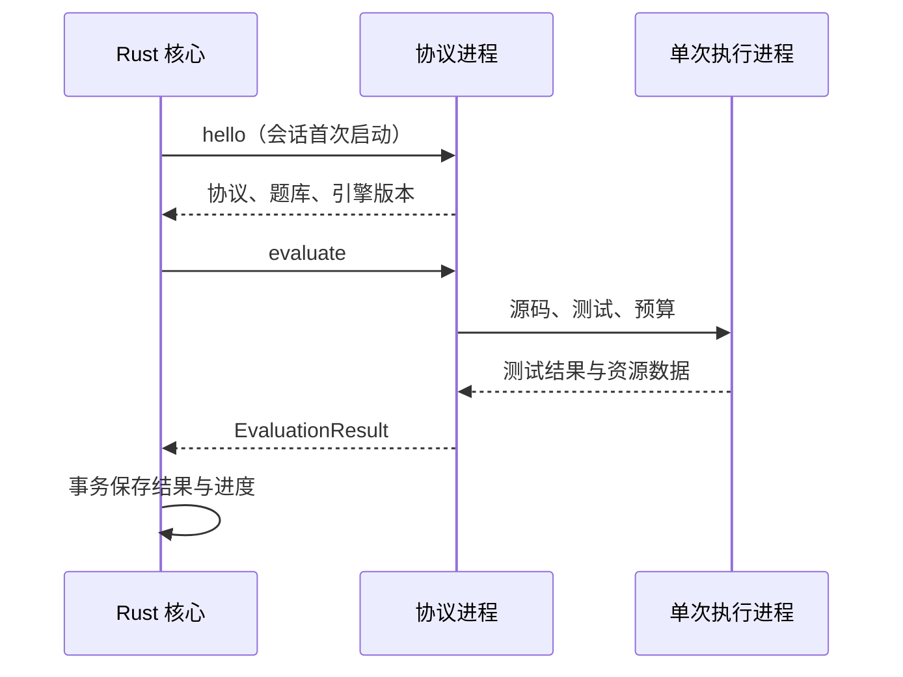

本地模块安装完成后，不会随每次打开题库常驻启动。Rust 在第一次评测时启动协议进程，后续评测复用会话；每个任务在独立执行进程中运行。

## 从安装到执行

1. 安装器校验清单签名、平台、协议、题库、文件大小和 SHA-256。
2. ZIP 解压到暂存目录，拒绝越界路径和符号链接。
3. Rust 启动候选入口并请求 `hello`，验证实际运行时的协议与题库。
4. 探测成功后，原子切换活动指针，后续提交按需启动该版本。

安装失败时，当前活动指针保持不变。已安装目录保留供回退，但每次激活仍验证兼容性并探测入口。

## 任务路径

协议 stdout 只输出换行分隔 JSON。用户打印输出由执行进程捕获并限制大小；诊断信息不应混入协议流。本地会话发生 IO、解析、超时或结果校验错误后被关闭，下次请求重新启动。

## 预算与超时

Python 任务默认 CPU/执行预算为10000ms、内存上限1GiB、输出上限16000字节，执行器还监测墙钟时间与进程内存。Rust 的60秒传输超时包含冷启动与握手；安装探测的握手上限为20秒。这些期限覆盖不同阶段，不能互相替代。

模块采用受限制的执行环境和一次性进程，用于本地教育练习。它不是针对任意恶意代码的完整主机安全沙箱；公开多租户服务需要另行提供隔离与资源调度。

## 空闲回收

桌面壳每15秒检查一次空闲状态，最后一次评测结束60秒后可以回收本地会话，因此通常在60–75秒内释放 Python 进程树。回收不会删除学习记录。再次运行需要承担冷启动成本。

当前只使用本地评测器，不提供远程服务生命周期管理。源码见[LocalEvaluator](https://github.com/BGWH123/Ember/blob/main/crates/ember-evaluator/src/local.rs)。
