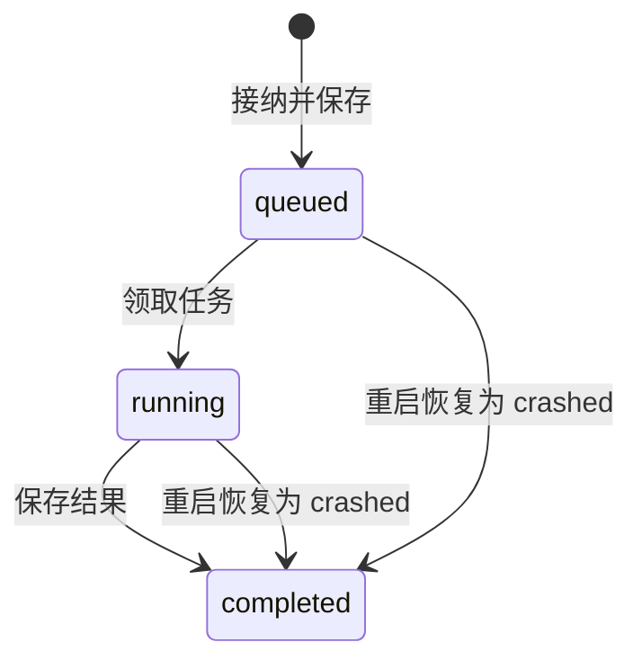

Rust 核心使用 OS app-data 目录中的 `ember-desktop.db` 保存学习记录。数据库位置由 Tauri 的平台路径决定，不复用旧版服务数据库。

## 数据归属

| 数据 | 行为 |
| --- | --- |
| `submissions` | 保存源码、运行模式、幂等键、状态和评测结果 |
| `progress` | 保存解题状态、尝试次数、最佳完整提交耗时和解决时间 |
| `drafts` | 按题目保存编辑器草稿，源码上限64000字节 |
| `imports` | 按旧库规范化路径和用户记录已完成的导入 |
| `desktop_schema` | 保存数据库 schema 版本，当前为1 |

题目内容不写入这组业务表，来自随应用打包的 catalog。安装模块与学习数据库也分别管理。

## 提交状态

`completed` 表示流程结束，不等于答题通过；具体结果位于 `outcome`。结果与进度在同一事务中提交。完整提交通过才标记 solved；样例通过只增加尝试。已经 solved 的状态不会因后续失败退回 attempted。基础设施崩溃不更新学习进度。

幂等键与任务、源码、运行模式和测试选择的指纹绑定。已完成的同一键可取回既有结果；同一键携带不同输入会被拒绝。当前运行中首先应用单任务准入，因此并发重复请求仍可能收到 Busy。

## 读写连接

数据库使用 WAL 和 `synchronous=FULL`。Storage 内部保留一个串行写连接和一个独立只读连接，各自持有 Mutex。历史、进度、草稿读取和结果读取使用只读连接，不等待写连接持有的 fsync 锁；读取只见已提交快照。

历史索引 `(problem_id, created_at)` 支持按题目取最近100条记录，按时间与 rowid 倒序排列。待执行任务使用仅覆盖 queued/running 的部分索引，避免随着历史增长扫描全部提交。应用关闭时先关闭 reader，再让最后的可写连接完成 WAL 清理。

## 导入与恢复

旧数据导入保持来源库只读，并在单个目标事务中完成。来源路径与用户的重复导入被拒绝。桌面启动将遗留 queued/running 记录为 crashed，保留诊断信息，不自动执行用户源码。

备份时关闭应用或使用 SQLite 一致性备份。模块回退不会回退学习数据库。实现与回归见[Storage](https://github.com/BGWH123/Ember/blob/main/crates/ember-core/src/storage.rs)。
